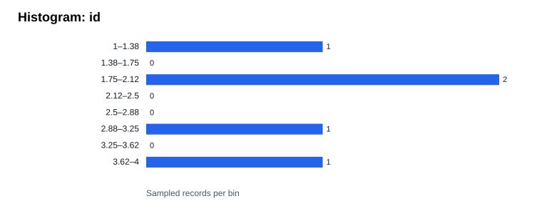
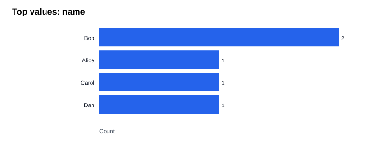
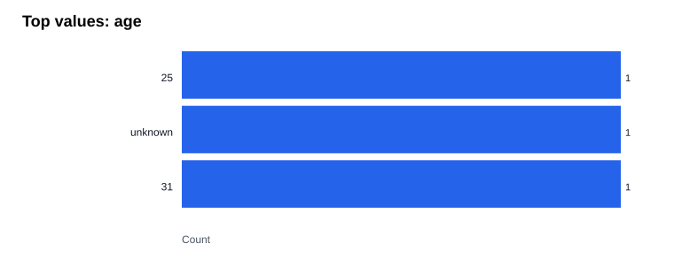
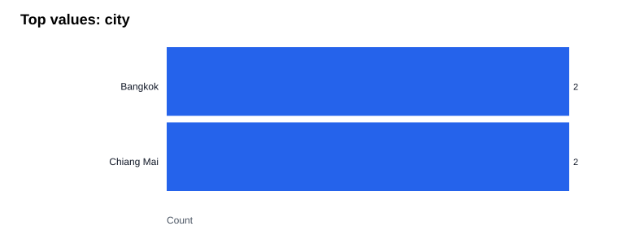

# Data Detective Report: sample.csv

## Quality overview

- Total rows: **5**
- Malformed rows: **0**
- Exact duplicates: **1**

| Column | Missing | Missing % | Mixed types? |
|---|---:|---:|---|
| id | 0 | 0.0% | No |
| name | 0 | 0.0% | No |
| age | 2 | 40.0% | Yes |
| city | 1 | 20.0% | No |

## Evidence-backed findings

- **REVIEW**: 1 exact duplicate records detected; verify whether repeated records are expected.
- **REVIEW**: age: 2 empty values among 5 structurally valid rows.
- **REVIEW**: age: multiple inferred value types; confirm intended schema.
- **REVIEW**: city: 1 empty values among 5 structurally valid rows.

## Exploratory data analysis

EDA sample: **5 / 5** valid rows (first rows, not random).

### id
- Numeric: mean **2.4**, median **2.0**, min **1.0**, max **4.0**, Q1 **2.0**, Q3 **3.0**

### name
- Categorical/text: **4** distinct sampled values

### age
- Categorical/text: **3** distinct sampled values

### city
- Categorical/text: **2** distinct sampled values

## Questions to confirm before interpreting

- What does each numeric column represent, particularly identifiers and codes?
- Are blank cells expected, or should they be treated as missing?
- Are exact duplicate records legitimate business events?
- Is the dataset ordered by date, group, or priority (which could bias first-row EDA)?

## Charts

## Important limitations

- All statistics and charts are descriptive and not causal evidence.
- EDA uses only the first N well-formed rows; results may be biased by row order.
- Numeric-looking identifiers can be classified as numbers; confirm column meaning.
- Reports and charts can expose data values. Review before sharing publicly.
- Input is read-only; no cleaning or imputation is applied.
